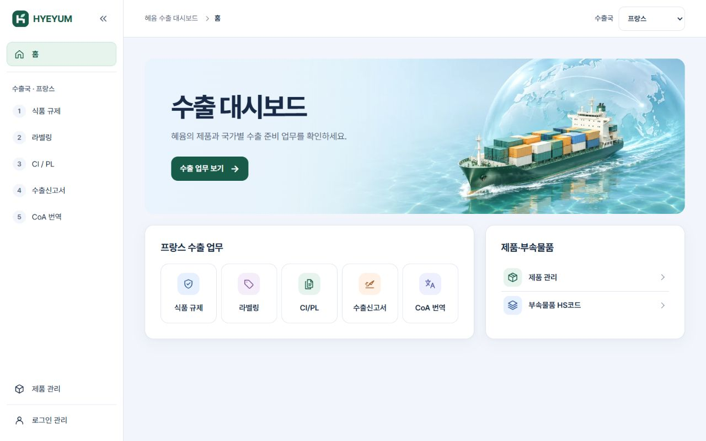

# E:YUM 디자인 가이드

공통 디자인은 새 화면을 시작할 때 참고하는 권장안이다. 기능 담당자는 자신의 화면에서 글꼴, 색상, 간격, 배치와 컴포넌트를 자유롭게 바꿀 수 있다. 예를 들어 라벨링 담당자는 편집 폼 옆에 라벨 미리보기를 두고, 제품 관리 담당자는 제품을 표로 보여줄 수 있다.

2026-11-26 초기 화면은 MediCore ‘Patient Care Hub’의 글자 위계와 밝은 배경, 흰 카드를 참고했다. 주요 동작에는 혜윰의 진녹색을 썼다. [팀 공유 레퍼런스 원본](design_references/dashboard_reference.png)



## 초기 화면의 기본값

| 용도 | 현재 공통 UI에서 쓰는 값 |
|---|---|
| 글꼴 | 기본 글꼴 변수는 `--font_body`다. 한글·영문·숫자는 앱에 포함한 Pretendard Variable 1.3.9로 표시한다. 로딩 중에는 Apple SD Gothic Neo와 맑은 고딕 등 기기 기본 글꼴을 사용한다. [배포 라이선스](../public/fonts/pretendard/LICENSE.txt) |
| 글자 위계 | 화면 제목은 한 번만 `h1`으로 표시한다. 업무 제목은 28~40px, 홈 배너 제목은 약 34~54px, 카드 제목(`h2`)은 18px, 본문은 15px, 보조 라벨은 13px를 기준으로 삼는다. |
| 배경과 글자 | 바깥은 푸른 기가 도는 밝은 배경(`--color_background`), 카드는 흰색(`--color_surface`), 제목과 본문은 짙은 남색(`--color_text`)을 쓴다. 단위와 보충 설명은 `--color_muted`를 쓴다. |
| 강조 | 현재 메뉴와 주요 동작은 `--color_primary`, 선택 배경은 `--color_primary_tint`를 사용한다. 옅은 파랑은 홈 배경이나 정보 안내에 사용한다. 아이콘과 색 옆에 동작명이나 상태를 글자로 표시한다. |
| 카드와 간격 | 공통 카드 `Panel`에는 테두리(`--color_border`), 모서리(`--radius_card`), 얕은 그림자(`--shadow_card`)가 적용돼 있다. 기본 여백 변수 `--space_2`~`--space_6`은 4px 간격이다. |

## 화면 구성

- **공통 틀.** `DashboardFrame`이 사이드바와 상단 수출국 선택을 제공한다. 기본 `select`는 처음에 ‘국가 선택’을 표시한다. 국가를 바꾸면 현재 탭에 머물고 탭을 바꾸면 선택 국가를 유지한다.
- **메뉴.** E:YUM by Hyeum 로고와 접기 버튼, 홈, 구분선, 국가 소제목, 다섯 업무 순으로 배치한다. 국가 선택 전 소제목은 ‘국가별 수출 업무’다. 현재 업무는 연녹색 배경, 진녹색 원형 번호와 굵은 글자로 표시한다. 제품 관리 아래 구분선 다음에는 계정 영역을 둔다. 로그인하면 원형 아바타 옆에 이름과 소속을 두 줄로 표시하고 오른쪽에 로그아웃 버튼을 둔다.
- **홈과 업무 화면.** 현재 홈은 국가별 업무와 제품 바로가기를 카드로 묶어 보여준다. 기본 업무 화면은 `FeatureScreen`이 제공하는 `PageHeading` 아래에 본문을 둔다. 제품과 부속물품 HS코드는 수출국 선택 전에도 접근할 수 있다.
- **입력과 상태.** 입력에는 보이는 라벨과 단위를 붙이고 오류를 해당 입력 가까이에 적는다. 저장 동작은 ‘저장 중·저장 완료·저장 실패’, 자료 검토는 ‘확인 필요’처럼 구분한다. 저장이 실패하면 입력값을 유지한다. 연동 전에는 준비 상태를 표시하고, 지표와 차트는 실데이터가 연결됐을 때 추가한다.

## 담당 화면에서 활용하는 예

아래는 라벨링 화면에 공통 제목과 카드가 어울릴 때 쓸 수 있는 예다. `FeatureScreen`은 수출국과 메뉴 이동을 처리하고, 본문에는 `Panel`이나 담당자가 만든 편집 폼·표·미리보기를 배치할 수 있다.

```tsx
import { FeatureScreen, type WorkspacePageProps } from "../../components/feature_screen";
import { Panel } from "../../components/panel";

export default function LabelsPage({ searchParams }: WorkspacePageProps) {
  return (
    <FeatureScreen slug="labels" searchParams={searchParams}>
      <Panel title="라벨 초안">
        <p>선택한 국가의 언어에 맞춰 제품 라벨을 준비합니다.</p>
      </Panel>
    </FeatureScreen>
  );
}
```

담당 탭의 스타일은 해당 페이지의 CSS 모듈에서 조정할 수 있다. 여러 탭에 영향을 주는 공통 CSS나 컴포넌트를 바꿀 때만 해당 담당자들과 조율한다. [공통 스타일](../src/app/globals.css) · [업무 화면](../src/components/feature_screen.tsx) · [카드](../src/components/panel.tsx)

## 화면을 바꾼 뒤 확인할 점

- 데스크톱과 모바일에서 제목과 주요 동작을 읽고 사용할 수 있는지 확인한다. 현재 홈은 360px 폭에서 카드가 한 열로 쌓이고, 800px 이하에서는 로고 옆 버튼으로 메뉴를 펼칠 수 있다.
- Tab 키로 메뉴, 수출국 선택, 본문 링크에 접근하고 초점 테두리를 확인한다. 프랑스를 선택해 제품 관리와 식품 규제로 이동한 뒤 같은 탭에서 싱가포르로 변경해 본다.
- 공통 스타일을 변경한 PR에는 홈과 영향을 받는 업무 탭에서 확인한 결과를 적는다. 린트·타입 검사·빌드 결과도 담당자 검증 기록에 남긴다.
